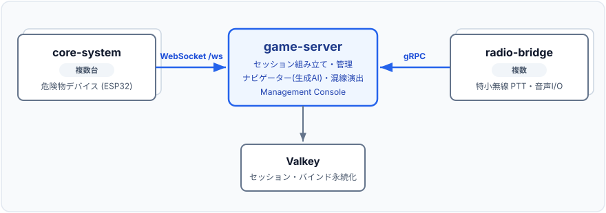

# リアル危険物解除ゲーム！ ～失敗すると風船がパン！～　
PJ:RADIO TERROR

特小無線(トランシーバー)を通じてAIナビゲーターと交信しながら、リアルな危険物を解除するゲーム・ハンズオンです。


> 無線の声を信じて、危険物を解除せよ
> 
> カウントダウンが刻まれる危険物。手元にはニッパーとトランシーバー。
> 無線の向こうにいるナビゲーターは現場を見ることができない。
> 頼れるのはあなたの目と、声と、無線越しの言葉だけ。
> 時折紛れ込む混線に惑わされず、正解のコードを見極めろ。
> 
> 息を呑むタイムリミットが、今始まる。

---

## ドキュメント

- [ゲームセッション設計](docs/game_session_design.md)
- [radio-bridge 接続設計](docs/bridge_connection_design.md)
- [体験運用フロー](docs/operation_flow.md)
- [謎解きステージ集](docs/puzzle_stage_ideas.md)
- [ナビゲーター設計](docs/navigator_design.md)
- [シナリオテンプレート設計](docs/scenario_design.md)
- [紙資料(別紙)制作仕様](docs/printed_materials.md)
- **[マネージャー運用マニュアル](docs/manager_manual.md)** — 当日の運営手順(現場で見る)

設計は確定済み(2026-08-08)。実装は設計に沿って完了している(2026-08-09)。

## 構成



周辺機器(Core・radio-bridge)はいずれも **サーバーへ接続する**。
サーバーは周辺機器のアドレスを一切管理しない。

| コンポーネント | 言語 | 役割 |
|---|---|---|
| `app/core-system` | C++ (ESP-IDF) | Core本体。セッションJSONを受け取り単体でゲームを完遂する |
| `app/game-server` | Go | セッション組み立て・ナビゲーター・混線・永続化・Management Console |

**編集して再起動すれば反映される設定**

| 場所 | 内容 |
|---|---|
| `app/game-server/scenarios/` | ステージ定義・難易度テンプレート |
| `app/game-server/navigator/` | ナビゲーターのキャラクター・プロンプト |
| `app/game-server/config.toml` | モデル・接続先・紙資料の物理定数など |
| `app/radio-bridge` | Rust | 特小無線とのPTT制御・音声入出力(Raspberry Pi) |
| `app/radio-bridge-emulator` | Go | radio-bridge の代替(PCのマイク・スピーカーを使う) |
| `app/radio-bridge-test-client` | Go | 動作確認用CLI(1つのbridgeとして振る舞う) |

## 動かす

```bash
cd app
cp game-server/config.sample.toml game-server/config.toml  # project/location を設定する
docker compose up
```

- マネージャー向け画面: <http://localhost:8080/manager>
- Coreの接続先とCoreIDは `idf.py menuconfig` の
  "Core System Configuration" で設定する(CoreIDは数字4桁)。

radio-bridge はチーム(周波数)ごとに1プロセス動かす。プロセスごとに変わる設定は
環境変数で指定し、`config.toml` は共有する:

| 環境変数 | 内容 |
|---|---|
| `RADIO_BRIDGE_ID` | この bridge の ID |
| `RADIO_BRIDGE_INPUT_DEVICE` | マイク側のオーディオIF (例 `hw:2,0`) |
| `RADIO_BRIDGE_OUTPUT_DEVICE` | スピーカー側のオーディオIF (例 `plughw:2,0`) |

デバイス名は実機で `aplay -l` / `arecord -l` で確認する。
チームを増やす場合は `compose.yaml` の `environment` だけ変えた
サービスを追加する。

## 制作物(コンテンツ)

コードとは別に、以下の制作が必要:

- 紙資料: モールス対照表・記号/数字シート・回路図シート・CoreID銘板。
  **印刷する表の中身と制作要件は [`docs/printed_materials.md`](docs/printed_materials.md)**
- 混線音声・効果音アセット(`app/game-server/assets/README.md` に
  ファイル名規約とセリフ一覧)
